# 🚗 CRMS - Gestion de Location de Voitures (Jakarta EE 10)
> **Plan d'Action & Découpage des Tâches en Binôme (Reda & Youssef)**  
> **Légende d'avancement :**  
> `[X]` = Tâche déjà réalisée et validée dans le code / commit Git  
> `[ ]` = Tâche restante à réaliser aujourd'hui  

---

## 📌 1. Vue d'ensemble du Projet & Architecture

Le projet est une application web d'entreprise développée en **Jakarta EE 10** (Servlets 6, JSP 3.1, JSTL 3.0, JPA / Hibernate 6, Java 17, MySQL, Tomcat 10.1+).  
Il permet la gestion complète d'une agence de location de voitures :
- **Véhicules & Parc automobile** (disponibilité, catégories, maintenance)
- **Offres promotionnelles** (remises en pourcentage sur des périodes définies)
- **Clients & Comptes** (profils, permis, inscription, rôles `USER` / `ADMIN`)
- **Réservations** (vérification disponibilité, calcul montants remisés)
- **Contrats de location** (génération, kilométrage départ/retour, facturation et clôture)

---

## 📐 2. Modèle de Données (Conforme au Diagramme UML)

```
       +---------------------------------------------+
       |                 Utilisateur                 |
       +---------------------------------------------+
       | - id : Long                                 |
       | - nom : String                              |
       | - prenom : String                           |
       | - email : String                            |
       | - motDePasse : String                       |
       | - telephone : String                        |
       | - role : Role (USER, ADMIN)                 |
       +---------------------------------------------+
                              ▲
                              | (hérite)
       +---------------------------------------------+
       |                   Client                    |
       +---------------------------------------------+
       | - adresse : String                          |
       | - numeroPermis : String                     |
       | - dateInscription : LocalDate               |
       +---------------------------------------------+
              | 1
              | effectue
              ▼ 0..*
+------------------------------------+  s'applique à   +------------------------------------+
|            Reservation             |◀----------------|               Offre                |
+------------------------------------+  0..1      0..* +------------------------------------+
| - id : Long                        |                 | - id : Long                        |
| - dateDebut : LocalDate            |                 | - titre : String                   |
| - dateFin : LocalDate              |                 | - description : String             |
| - montantTotal : Double            |                 | - pourcentageRemise : Double       |
| - statut : StatutReservation       |                 | - dateDebut : LocalDate            |
|   (EN_ATTENTE, CONFIRMEE,          |                 | - dateFin : LocalDate              |
|    ANNULEE, TERMINEE)              |                 +------------------------------------+
+------------------------------------+
       | 0..*               | 1
       | concerne           | donne lieu à
       ▼ 1                  ▼ 0..1
+--------------------+ +------------------------------------+
|      Vehicule      | |              Contrat               |
+--------------------+ +------------------------------------+
| - id : Long        | | - id : Long                        |
| - marque : String  | | - dateDebut : LocalDate            |
| - modele : String  | | - dateFin : LocalDate              |
| - immatriculation  | | - montant : Double                 |
| - annee : Integer  | | - kmDepart : Integer               |
| - categorie : Str  | | - kmRetour : Integer               |
| - prixParJour : Dbl| | - statut : StatutContrat           |
| - statut : StatutV | |   (ACTIF, TERMINE)                 |
|   (DISPONIBLE,     | +------------------------------------+
|    LOUE,           |
|    EN_MAINTENANCE) |
+--------------------+
```

---

## 📦 3. Bilan de l'Existant & Tâches Déjà Réalisées (Commits par Reda & Youssef)

Une analyse approfondie de l'historique Git (`git log`) et de l'arborescence du code source montre une base de travail déjà solide et structurée :

### 🔴 A. Tâches Réalisées par REDA (`Reda-Ganoutre01` - 21 commits)

- [X] **Configuration du Projet & Socle Technique :**
  - [X] Mise en place du projet Maven WAR sous **Java 17** (`pom.xml`, plugin compilateur Maven 3.13.0). *(Commits 51c0f39, 1e2e33c)*
  - [X] Configuration de JPA / Hibernate 6 (`src/main/resources/META-INF/persistence.xml`) avec dialecte MySQL et création automatique du schéma (`update`). *(Commits 9e71bc4, 359c925)*
  - [X] Implémentation du singleton `JPAUtil.java` pour la gestion centralisée de l'`EntityManagerFactory`. *(Commit 33763e1)*
  - [X] Création de `AppListener.java` (`ServletContextListener`) assurant la fermeture propre de l'`EntityManagerFactory` à l'arrêt du conteneur. *(Commit 02a1b53)*
  - [X] Ajout du filtre `EncodingFilter.java` pour forcer l'encodage `UTF-8` sur les requêtes et réponses HTTP. *(Commit 87c82cc)*

- [X] **Entités JPA & Modèles :**
  - [X] Création initiale des entités JPA : `Client.java`, `Vehicule.java` et `Contrat.java`. *(Commits 7716a3a, 72f2ddc, ec4ded5)*
  - [X] Refactorisation complète des entités avec les annotations **Lombok** (`@Getter`, `@Setter`, `@NoArgsConstructor`) pour supprimer le code verbeux. *(Commits 012d0c9, 6e903f1, e9514ec, 4951c43)*
  - [X] Ajout des méthodes utilitaires métier : `getLibelle()` sur `Vehicule` et `getNomComplet()` sur `Client`. *(Commit 43d478b)*

- [X] **Couche Persistance (DAO) :**
  - [X] Création de la classe générique `GenericDAO<T>` fournissant les opérations CRUD standards (`save`, `findById`, `findAll`, `count`, `delete`) avec gestion robuste des transactions JPA (`begin`, `commit`, `rollback`, `close`). *(Commit 28216fb)*
  - [X] Implémentation de `VehiculeDAO.java` avec méthodes de filtrage : `countDisponibles()`, `findDisponibles()`. *(Commit 45b5d33)*
  - [X] Implémentation de `ContratDAO.java` avec méthodes métier : `countEnCours()`, `chiffreAffaires()`, `findRecent(limit)`. *(Commit 09b004e)*
  - [X] Implémentation de `ClientDAO.java` étendant `GenericDAO<Client>`. *(Commits 12fd3ff, 8f5de44)*

- [X] **Base de Données & Interface Web :**
  - [X] Création du script d'initialisation SQL `sql/location.sql` avec tables et jeu de données de test (voitures, clients). *(Commit d146562)*
  - [X] Création de `HomeServlet.java` (`/accueil`) pour agréger les KPI et transférer vers la vue dashboard. *(Commit 88f4782)*
  - [X] Redirection automatique sur `index.jsp` vers `/accueil`. *(Commit 2b9aaff)*
  - [X] Création de la feuille de styles CSS responsive `style.css`. *(Commit 7d6f887)*
  - [X] Conception du banc de test interactif `index.html` (cartes statistiques, tableaux, console de requêtes API).

---

### 🔵 B. Tâches Réalisées par YOUSSEF (`Elmeliani-y` - Commits `d058968` et `0eb6e6c`)

- [X] **Extension du Modèle de Données & Relations Métier (Commit `d058968`) :**
  - [X] Création de l'entité `Utilisateur.java` avec stratégie d'héritage `@Inheritance(strategy = InheritanceType.JOINED)`.
  - [X] Création de la classe `Administrateur.java` étendant `Utilisateur`.
  - [X] Création de l'entité `Reservation.java` avec gestion des dates (`LocalDate`), calcul du montant et statut.
  - [X] Création de l'entité `Offre.java` pour les campagnes de remise (`pourcentageRemise`, périodes de validité).
  - [X] Création des énumérations `StatutVehicule` (`DISPONIBLE`, `LOUE`, `EN_MAINTENANCE`) et `StatutReservation` (`EN_ATTENTE`, `CONFIRMEE`, `ANNULEE`, `TERMINEE`).

- [X] **Système de Sécurité & API d'Authentification (Commit `0eb6e6c`) :**
  - [X] Implémentation de `AuthDao.java` :
    - [X] Sécurisation des mots de passe par hachage fort **BCrypt** (`hashPassword`, `checkpw`).
    - [X] Création et signature de jetons **JWT** (via `jjwt`) avec expiration et claims de rôle (`USER`, `ADMIN`).
    - [X] Parsing et validation des tokens JWT.
    - [X] Recherche d'utilisateur insensible à la casse (`findByEmail`).
  - [X] Implémentation complète de `AuthApiServlet.java` (`/api/auth/*`) :
    - [X] `POST /api/auth/login` : authentification et génération de cookie sécurisé `HttpOnly` contenant le JWT.
    - [X] `POST /api/auth/register` : inscription d'un nouveau client avec validation des champs.
    - [X] `POST /api/auth/logout` : révocation du cookie d'authentification.
    - [X] `GET /api/auth/me` : consultation du profil connecté via le jeton.
    - [X] `PUT /api/auth/password` : changement sécurisé de mot de passe.
    - [X] Intégration de **Jackson Databind** pour la sérialisation/désérialisation JSON.

- [X] **Spécification des Contrats d'API (Commit `0eb6e6c`) :**
  - [X] Rédaction complète du document `docs/API.md` (spécification formelle de tous les endpoints REST : Clients, Véhicules, Réservations, Contrats, Offres, Statistiques, codes d'erreurs HTTP).

---

### 📊 C. Matrice Synthétique d'Avancement Global

| Couche Logicielle | État Actuel | Réalisé (Reda & Youssef) | Reste à Faire Aujourd'hui |
| :--- | :---: | :--- | :--- |
| **1. Configuration & Build** | **100%** | `[X]` Maven, Java 17, Tomcat 10, Lombok, JWT, BCrypt, MySQL | `[ ]` Package WAR final & déploiement |
| **2. Modèle de Données (JPA)** | **85%** | `[X]` Utilisateur, Client, Admin, Vehicule, Contrat, Reservation, Offre | `[ ]` Ajouter enum `Role`, enum `StatutContrat`, harmoniser champs |
| **3. Persistance (DAOs)** | **70%** | `[X]` GenericDAO, AuthDao, VehiculeDAO, ContratDAO, ClientDAO | `[ ]` Créer `OffreDAO` (Reda) & `ReservationDAO` (Youssef) |
| **4. Logique Métier (Services)**| **20%** | `[X]` Hachage mot de passe, tokens JWT, calculs basiques contrats | `[ ]` `VehiculeService`, `OffreService`, `ReservationService`, `ContratService` |
| **5. Contrôleurs (Servlets)** | **35%** | `[X]` AuthApiServlet, HomeServlet | `[ ]` `VehiculeServlet`, `OffreServlet`, `ReservationServlet`, `ContratServlet` |
| **6. Vues Utilisateur (JSP/UI)** | **25%** | `[X]` `index.html` (console API), `style.css`, redirection `index.jsp` | `[ ]` Vues JSP : dashboard.jsp, gestion véhicules, réservations, factures |

---

## 👥 4. Découpage du Binôme (Séparation Verticale Anti-Conflits)

Pour travailler simultanément toute la journée sans jamais se bloquer ni créer de conflits Git, le projet est découpé en **2 domaines autonomes** :

| Membre | Rôle / Périmètre Principal | Entités & Fichiers dédiés |
| :--- | :--- | :--- |
| 🔴 **REDA** | **Lead Flotte, Promotions & Dashboard** | `Vehicule`, `StatutVehicule`, `Offre`, `VehiculeDAO`, `OffreDAO`, `VehiculeService`, `OffreService`, `DashboardService`, Servlets Véhicules/Offres & JSPs associées |
| 🔵 **YOUSSEF** | **Lead Clients, Réservations & Contrats** | `Utilisateur`, `Client`, `Role`, `Reservation`, `StatutReservation`, `Contrat`, `StatutContrat`, DAOs Clients/Réservations/Contrats, Services associés, Servlets & JSPs |

---

## ⏰ 5. Planning Heure par Heure de la Journée

```mermaid
gantt
    title Planning de la journée (Finalisation CRMS)
    dateFormat HH:mm
    axisFormat %H:%M

    section Phase 0 : Ensemble
    Cadrage, Modèles & Git Setup     :09:00, 45m

    section REDA (Flotte & Offres)
    Entités & DAOs Véhicules/Offres :09:45, 75m
    Services & Logique Métier       :11:00, 60m
    Servlets & APIs                 :13:00, 75m
    Vues JSP & Dashboard            :14:15, 90m

    section YOUSSEF (Clients & Contrats)
    Entités & DAOs Auth/Res/Contrat :09:45, 75m
    Services Réservation & Contrat  :11:00, 60m
    Servlets & Contrôleurs Flux     :13:00, 75m
    Vues JSP Formulaires & Factures :14:15, 90m

    section Phase Finale : Ensemble
    Merge Git & Intégration         :15:45, 60m
    Tests E2E & Déploiement Tomcat  :16:45, 45m
    Documentation & Préparation Démo:17:30, 30m
```



---

## 🌿 6. Stratégie Git & Règles de Travail en Parallèle

### A. Initialisation des branches
Chaque personne travaille sur sa branche dédiée :
```bash
# REDA :
git checkout -b feature/reda-flotte-offres

# YOUSSEF :
git checkout -b feature/youssef-clients-contrats
```

### B. Règles d'or pour éviter tout blocage
1. **Ne pas modifier les fichiers de l'autre** pendant la journée.
2. **Utiliser des interfaces / signatures claires** : si Youssef a besoin d'un véhicule disponible, il appelle `vehiculeDAO.findById(id)` ou `vehiculeDAO.findDisponibles()`.
3. **Commit fréquent** avec des messages clairs (`git commit -m "feat(vehicule): ajout filtre statut"`).
4. **Synchronisation à 15h45** pour le merge final sur `main`.

---

## 🔴 7. Plan d'Action Détaillé pour REDA

### Périmètre : Flotte automobile, Offres spéciales & Dashboard KPI

#### Étape 1 : Modèles, Config & Persistance (09h45 - 11h00)
- [X] Configurer le projet Maven WAR sous Java 17 avec toutes les dépendances Jakarta EE 10 (`pom.xml`).
- [X] Configurer la persistance JPA / Hibernate 6 (`persistence.xml`) pour MySQL.
- [X] Mettre en place `JPAUtil.java`, `AppListener.java` et `EncodingFilter.java`.
- [X] Créer le script SQL d'initialisation de la base de données `sql/location.sql`.
- [X] Créer l'entité `Vehicule.java` avec champs de base, getters/setters Lombok et `getLibelle()`.
- [X] Créer l'entité `Offre.java` avec `titre`, `description`, `pourcentageRemise`, `dateDebut`, `dateFin`.
- [X] Créer `GenericDAO.java` pour factoriser toutes les opérations CRUD et transactions JPA.
- [X] Créer `VehiculeDAO.java` avec les requêtes `findDisponibles()` et `countDisponibles()`.
- [ ] Aligner `Vehicule.java` avec le diagramme UML :
  - Ajouter le champ `categorie` (citadine, berline, SUV, etc.).
  - Harmoniser `prixParJour` en type `Double`.
  - Vérifier l'énumération `StatutVehicule` (`DISPONIBLE`, `LOUE`, `EN_MAINTENANCE`).
- [ ] Créer `OffreDAO.java` étendant `GenericDAO<Offre>` :
  - Ajouter la méthode `findOffresActives(LocalDate date)`.
- [ ] Enrichir `VehiculeDAO.java` :
  - Méthodes `findByCategorie(String cat)`, `updateStatut(Long id, StatutVehicule statut)`.

#### Étape 2 : Services & Logique Métier (11h00 - 12h00)
- [ ] Créer `ma.location.service.VehiculeService` :
  - Validation des données véhicule (immatriculation unique, format, prix > 0).
  - Gestion du cycle de maintenance d'un véhicule (`DISPONIBLE` -> `EN_MAINTENANCE`).
  - Calcul de disponibilité.
- [ ] Créer `ma.location.service.OffreService` :
  - Validation des dates d'une offre (`dateDebut < dateFin`).
  - Calcul du montant remisé : `montantNet = montantBrut * (1 - remise / 100)`.
- [ ] Créer `ma.location.service.DashboardService` :
  - Comptage total véhicules, véhicules loués, taux d'occupation, chiffre d'affaires.

#### Étape 3 : Servlets / Contrôleurs (13h00 - 14h15)
- [X] Créer `HomeServlet.java` (`/accueil`) pour agréger les statistiques du tableau de bord.
- [X] Configurer la redirection automatique vers `/accueil` dans `index.jsp`.
- [ ] Créer `VehiculeServlet.java` (`/vehicules` et `/admin/vehicules`) :
  - `GET /vehicules` : Catalogue public avec filtres (marque, catégorie, prix).
  - `GET /admin/vehicules/nouveau` : Formulaire d'ajout (Admin).
  - `POST /admin/vehicules/save` : Enregistrement ou mise à jour.
  - `POST /admin/vehicules/delete` : Suppression logique ou physique.
  - `POST /admin/vehicules/maintenance` : Passage en maintenance.
- [ ] Créer `OffreServlet.java` (`/offres` et `/admin/offres`) :
  - `GET /offres` : Liste des promotions actives pour les clients.
  - `POST /admin/offres/save` : Création de code promo / offre par l'administrateur.

#### Étape 4 : Vues Web & Ergonomie (14h15 - 15h45)
- [X] Créer la feuille de style responsive `src/main/webapp/css/style.css`.
- [X] Concevoir la page de test interactif `index.html`.
- [ ] Créer `src/main/webapp/WEB-INF/views/vehicules/liste.jsp` (cartes véhicules avec badge de statut).
- [ ] Créer `src/main/webapp/WEB-INF/views/vehicules/form.jsp` (ajout / édition avec sélecteur de catégorie).
- [ ] Créer `src/main/webapp/WEB-INF/views/offres/liste.jsp` (bannières promo avec pourcentage de réduction).
- [ ] Créer `src/main/webapp/WEB-INF/views/dashboard.jsp` (KPIs chiffrés, raccourcis rapides, design propre).

---

## 🔵 8. Plan d'Action Détaillé pour YOUSSEF

### Périmètre : Comptes Clients, Réservations & Cycle de Vie des Contrats

#### Étape 1 : Modèles, Config & Persistance (09h45 - 11h00)
- [X] Créer `Utilisateur.java` avec stratégie d'héritage `@Inheritance(strategy = InheritanceType.JOINED)`.
- [X] Créer `Administrateur.java` étendant `Utilisateur`.
- [X] Créer `Client.java` étendant `Utilisateur` avec annotations Lombok, `cin`, `adresse`, `numeroPermis`, `getNomComplet()`.
- [X] Créer `Reservation.java` avec relations Client, Véhicule, Offre, dates et montant total.
- [X] Créer les énumérations `StatutVehicule.java` et `StatutReservation.java`.
- [X] Créer `Contrat.java` avec relations Client et Véhicule, dates, montant, `kmDepart`, `kmRetour`.
- [X] Créer `ClientDAO.java` étendant `GenericDAO<Client>`.
- [X] Créer `ContratDAO.java` avec requêtes métier (`countEnCours()`, `chiffreAffaires()`, `findRecent()`).
- [ ] Créer l'énumération `Role.java` (`USER`, `ADMIN`) et l'ajouter à `Utilisateur.java`.
- [ ] Ajouter le champ `dateInscription : LocalDate` dans `Client.java`.
- [ ] Créer l'énumération `StatutContrat.java` (`ACTIF`, `TERMINE`) et lier dans `Contrat.java`.
- [ ] Créer `ReservationDAO.java` étendant `GenericDAO<Reservation>` :
  - `findByClient(Long clientId)`.
  - `isVehiculeDisponible(Long vehiculeId, LocalDate debut, LocalDate fin)`.
- [ ] Compléter `ContratDAO.java` avec recherche des contrats actifs et gestion des kilomètres.

#### Étape 2 : Services & Logique Métier / Sécurité (11h00 - 12h00)
- [X] Implémenter le hachage sécurisé des mots de passe avec **BCrypt** (`hashPassword`, `checkpw`) dans `AuthDao.java`.
- [X] Implémenter la création, signature et validation des jetons **JWT** dans `AuthDao.java`.
- [X] Implémenter la recherche insensible à la casse d'un utilisateur par email (`findByEmail`).
- [ ] Créer `ma.location.service.ReservationService` :
  - Vérification anti-chevauchement des dates sur le véhicule sélectionné.
  - Calcul du montant total : `(dateFin - dateDebut) * prixJour` déduit de l'offre si sélectionnée.
  - Transition de statut : validation admin d'une réservation (`CONFIRMEE`).
- [ ] Créer `ma.location.service.ContratService` :
  - Génération de contrat à partir d'une réservation confirmée.
  - Validation du kilométrage de retour (`kmRetour >= kmDepart`).
  - Clôture du contrat : calcul du solde final, libération du véhicule (`DISPONIBLE`).
- [ ] Créer `ma.location.service.ClientService` / Sécurité :
  - Gestion des sessions HTTP utilisateur (Client vs Admin).

#### Étape 3 : Servlets / Contrôleurs / API (13h00 - 14h15)
- [X] Créer `AuthApiServlet.java` (`/api/auth/*` : login, register, logout, me, password).
- [X] Mettre en place le cookie de sécurité `HttpOnly` pour le stockage du jeton JWT.
- [X] Rédiger le contrat d'API REST exhaustif dans `docs/API.md`.
- [ ] Créer `AuthServlet.java` (`/login`, `/register`, `/logout`) basé sur session HTTP et redirections JSP.
- [ ] Créer `ReservationServlet.java` (`/reservations`) :
  - `GET /reservations/nouvelle?vehiculeId=X` : Formulaire de réservation.
  - `POST /reservations/creer` : Validation et enregistrement statut `EN_ATTENTE`.
  - `GET /mes-reservations` : Historique du client connecté.
  - `POST /admin/reservations/valider` : Confirmation par l'administrateur.
- [ ] Créer `ContratServlet.java` (`/admin/contrats`) :
  - `POST /admin/contrats/demarrer` : Enregistrement `kmDepart`, passage contrat `ACTIF`.
  - `POST /admin/contrats/cloturer` : Saisie `kmRetour`, passage contrat `TERMINE`.
  - `GET /contrats/facture?id=X` : Vue imprimable de la facture de location.

#### Étape 4 : Vues Web & Formulaires (14h15 - 15h45)
- [ ] Créer `src/main/webapp/WEB-INF/views/auth/login.jsp` & `register.jsp`.
- [ ] Créer `src/main/webapp/WEB-INF/views/reservations/form.jsp` (sélection dates avec calcul immédiat).
- [ ] Créer `src/main/webapp/WEB-INF/views/reservations/liste.jsp` (tableau avec boutons d'action d'état).
- [ ] Créer `src/main/webapp/WEB-INF/views/contrats/liste.jsp` & `facture.jsp` (détail du montant, km parcourus, signature).

---

## 🤝 9. Contrat d'Intégration entre Reda et Youssef (15h45 - 16h45)

Quand les deux branches seront fusionnées sur `main`, les deux modules s'interconnectent automatiquement grâce à ces 3 points de contact convenus :

1. **Vérification de disponibilité avant réservation :**
   ```java
   // Dans ReservationService (Youssef) appelant VehiculeDAO (Reda) :
   Vehicule v = vehiculeDAO.findById(vehiculeId);
   if (v.getStatut() != StatutVehicule.DISPONIBLE) {
       throw new IllegalStateException("Véhicule indisponible !");
   }
   ```
2. **Application automatique d'une offre :**
   ```java
   // Dans ReservationService (Youssef) appelant OffreService (Reda) :
   double remise = (offre != null) ? offre.getPourcentageRemise() : 0.0;
   double total = nbJours * v.getPrixParJour() * (1 - remise / 100.0);
   ```
3. **Mise à jour du statut véhicule lors du contrat :**
   ```java
   // Démarrage contrat (Youssef) -> mise à jour du statut (Reda) :
   vehicule.setStatut(StatutVehicule.LOUE);
   // Clôture contrat (Youssef) -> libération du statut (Reda) :
   vehicule.setStatut(StatutVehicule.DISPONIBLE);
   ```

---

## 🧪 10. Protocole de Test Final (16h45 - 17h30)

Tester le scénario complet de bout en bout sur l'application déployée :
1. **Création du compte Client** : Inscription de "Reda / Youssef" via `/register`.
2. **Création d'un Véhicule & Offre (Admin)** :
   - Ajout d'une *Peugeot 208* à 350 DH/jour, statut `DISPONIBLE`.
   - Ajout d'une offre *Promo Fin d'Année* de -15%.
3. **Passage de Réservation (Client)** :
   - Sélection du véhicule pour 4 jours avec application de l'offre.
   - Montant vérifié : `4 * 350 * 0.85 = 1190 DH`.
4. **Validation et Contrat (Admin)** :
   - Confirmation de la réservation.
   - Démarrage du contrat avec km départ = `50 000 km`.
   - Vérification que la voiture passe à l'état `LOUE`.
5. **Clôture et Facture (Admin)** :
   - Clôture du contrat avec km retour = `50 450 km`.
   - Vérification que la voiture repasse à `DISPONIBLE`.
   - Affichage de la facture finale.
6. **Dashboard** :
   - Vérification de l'incrémentation du chiffre d'affaires et du nombre de contrats.

---

## 🚀 11. Commandes de Compilation et Déploiement

```bash
# 1. Vérifier la compilation Java 17
mvn clean test-compile

# 2. Packager le fichier WAR
mvn clean package

# 3. Le fichier prêt pour Tomcat 10+ se trouvera dans :
# target/location-voitures.war

# 4. URL d'accès local :
# http://localhost:8080/location-voitures/
```
