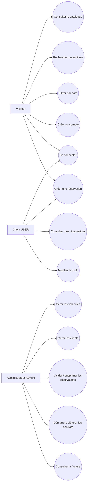
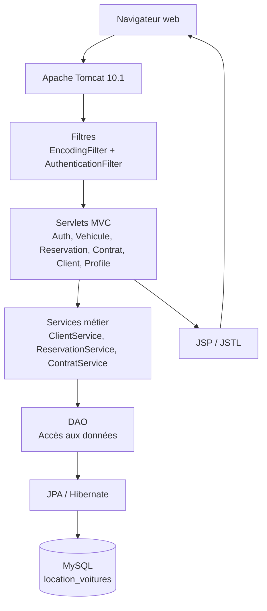
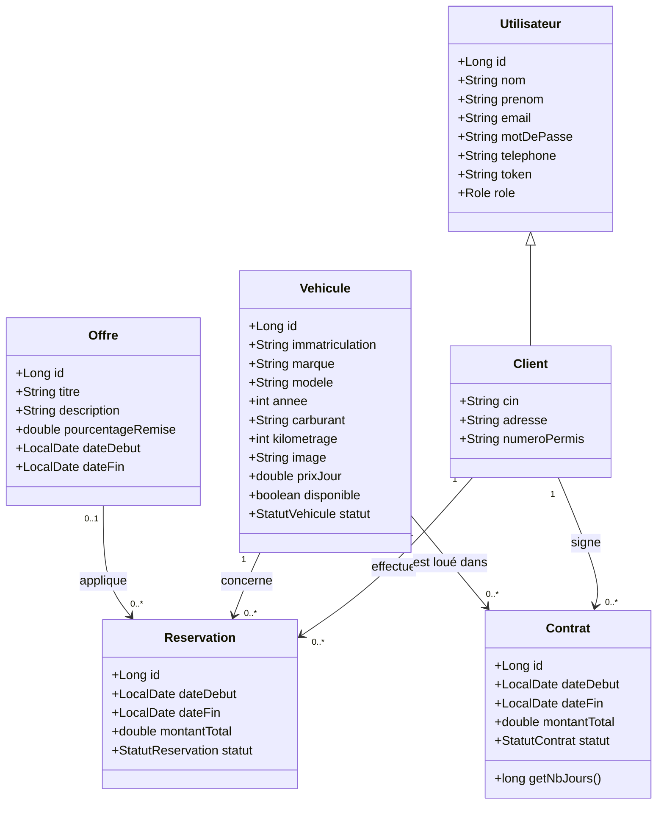
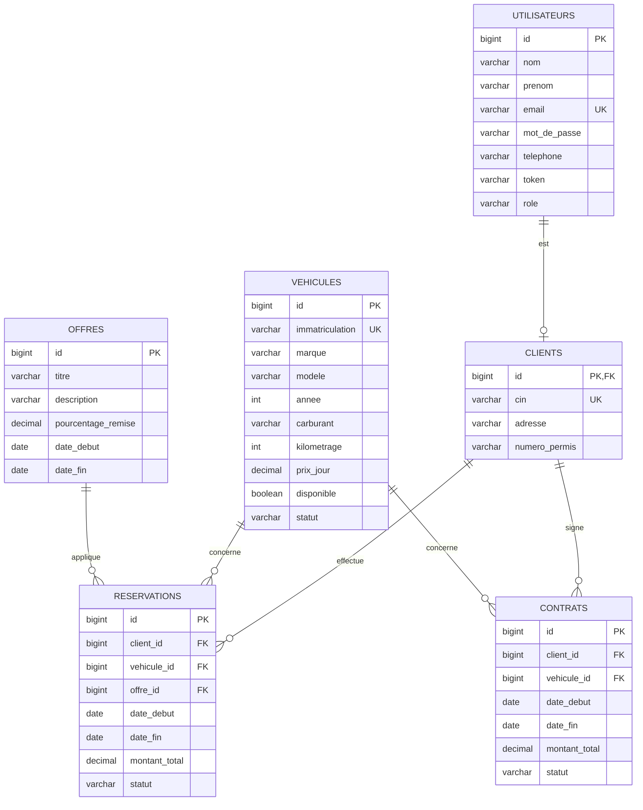
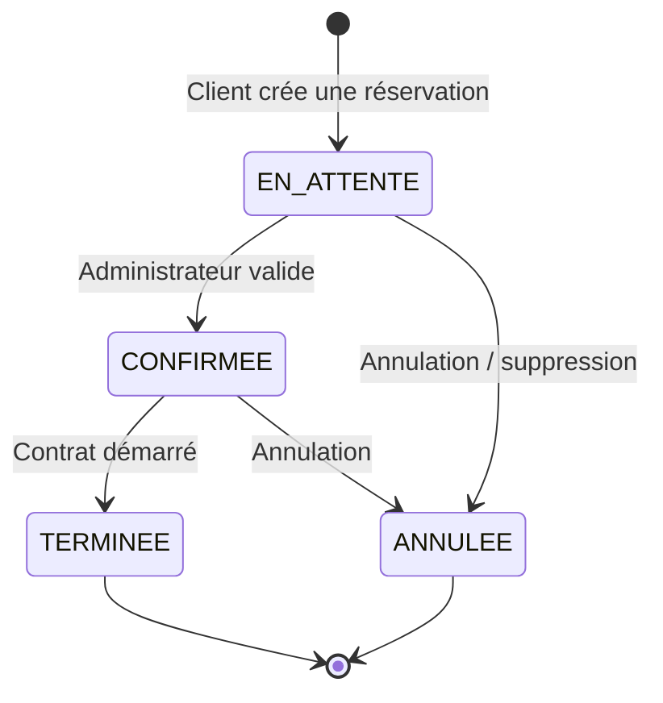
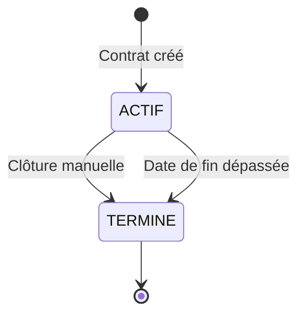
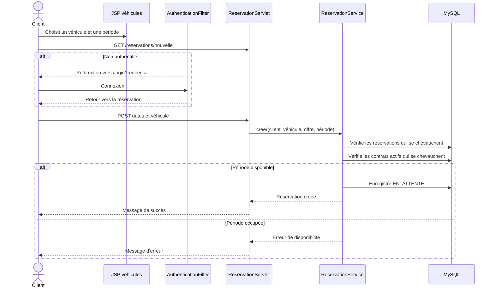
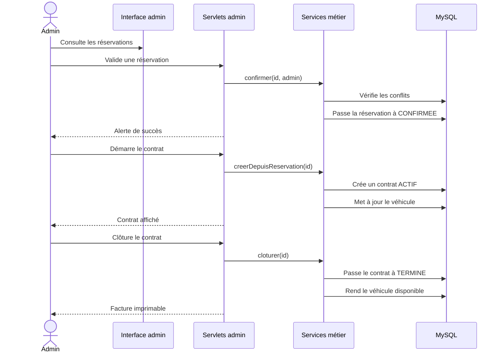

# Rapport de projet - CRMS

## 1. Présentation générale

**CRMS** est une application web de gestion d'une agence de location de voitures. Elle permet de publier un parc automobile, de gérer les clients, de recevoir des demandes de réservation, de transformer une réservation confirmée en contrat et de suivre la facturation.

L'application est réalisée avec Java 17 et Jakarta EE 10. Elle utilise des Servlets, des pages JSP/JSTL, JPA avec Hibernate et une base de données MySQL. L'application est empaquetée sous forme de fichier WAR et exécutée sur Apache Tomcat 10.1 ou supérieur.

## 2. Objectifs

- Centraliser la gestion des véhicules et de leur disponibilité.
- Permettre aux visiteurs de consulter le catalogue sans authentification.
- Permettre aux clients de créer un compte et d'envoyer des réservations.
- Éviter les doubles réservations sur des périodes qui se chevauchent.
- Donner à l'administrateur une vue complète sur les clients, réservations et contrats.
- Automatiser le calcul des montants et la mise à jour des contrats expirés.
- Fournir une facture consultable et imprimable pour chaque contrat.

## 3. Acteurs et droits

| Acteur | Droits principaux |
|---|---|
| Visiteur | Voir les véhicules, rechercher, filtrer par date, accéder à la connexion et à l'inscription |
| Client (`USER`) | Gérer son profil, créer une réservation et consulter ses réservations |
| Administrateur (`ADMIN`) | Gérer les véhicules, clients, réservations et contrats |

### Diagramme des cas d'utilisation



## 4. Architecture technique

L'application suit une architecture en couches :



### Organisation du code

```text
src/main/java/ma/location/
├── model/       Entités JPA et énumérations
├── dao/         Requêtes et opérations de persistence
├── service/     Règles métier et validations
├── servlet/     Contrôleurs HTTP et API
├── filter/      Encodage et authentification
└── util/        JPA, initialisation, images

src/main/webapp/
├── WEB-INF/views/   Pages JSP
├── WEB-INF/jspf/    Fragments partagés
└── images/          Images statiques
```

## 5. Modèle de données

### Diagramme de classes métier



### Modèle relationnel simplifié



## 6. États métier





Les états utilisés par le domaine sont :

```text
Reservation : EN_ATTENTE, CONFIRMEE, ANNULEE, TERMINEE
Contrat     : ACTIF, TERMINE
Vehicule    : DISPONIBLE, LOUE, EN_MAINTENANCE
Utilisateur : USER, ADMIN
```

## 7. Processus de réservation



La règle de chevauchement est :

```text
dateDebutExistante < dateFinDemandee
ET
dateFinExistante > dateDebutDemandee
```

Une réservation `EN_ATTENTE` ou `CONFIRMEE`, ainsi qu'un contrat `ACTIF`, bloque le véhicule uniquement sur la période concernée. Les réservations `ANNULEE` et `TERMINEE` ne bloquent pas une nouvelle réservation.

## 8. Processus administratif



## 9. Disponibilité des véhicules

La disponibilité présentée dans le catalogue est calculée selon deux notions :

1. **Disponibilité actuelle** : le véhicule est considéré indisponible si une réservation `EN_ATTENTE` ou `CONFIRMEE`, ou un contrat `ACTIF`, couvre la date du jour.
2. **Disponibilité à partir d'une date** : le filtre exclut les véhicules dont une réservation ou un contrat actif couvre la date demandée.

Les contrats actifs dont `dateFin <= aujourd'hui` sont automatiquement clôturés lors de certains chargements applicatifs. Cette synchronisation remet également le véhicule à l'état disponible.

## 10. Authentification et sécurité

- Les mots de passe sont hachés avec BCrypt.
- Le rôle est stocké dans la session après authentification.
- `AuthenticationFilter` protège les routes privées.
- Les routes publiques comprennent le catalogue, la connexion, l'inscription, la déconnexion et les ressources statiques.
- Les opérations d'administration vérifient explicitement le rôle `ADMIN` dans les servlets et services.
- Les redirections de connexion conservent la destination demandée après authentification.
- Les réponses et messages affichés utilisent les mécanismes JSP d'échappement lorsque cela est nécessaire.

## 11. Routes principales

| Route | Méthode | Accès | Rôle |
|---|---|---|---|
| `/vehicules` | GET | Public | Catalogue et filtres |
| `/login` | GET/POST | Public | Connexion |
| `/register` | GET/POST | Public | Création de compte |
| `/logout` | GET/POST | Authentifié | Déconnexion |
| `/mes-reservations` | GET | Client | Réservations personnelles |
| `/reservations/nouvelle` | GET/POST | Client | Création de réservation |
| `/admin/reservations` | GET | Admin | Liste des réservations |
| `/admin/reservations/valider` | POST | Admin | Validation |
| `/admin/contrats` | GET | Admin | Liste des contrats |
| `/admin/contrats/demarrer` | POST | Admin | Création d'un contrat |
| `/admin/contrats/cloturer` | POST | Admin | Clôture et facture |
| `/clients` | GET | Admin | Gestion des clients |
| `/profile` | GET/POST | Client | Gestion du profil |

La documentation de l'API d'authentification est disponible dans [`docs/API.md`](docs/API.md). Les endpoints REST décrits comme futurs dans ce document doivent être distingués des routes web JSP réellement disponibles.

## 12. Installation et déploiement

### Prérequis

- JDK 17.
- Maven 3.9 ou supérieur.
- MySQL 8.x.
- Tomcat 10.1 ou supérieur.

### Configuration

La persistence est définie dans `src/main/resources/META-INF/persistence.xml`. La configuration locale par défaut utilise :

```text
URL      jdbc:mysql://localhost:3306/location_voitures
Utilisateur root
Mot de passe 1234
```

Pour un déploiement réel, il faut remplacer les identifiants par un compte MySQL dédié et ne pas conserver de mot de passe sensible dans le dépôt.

### Compilation

```bash
mvn clean package
```

Le fichier généré est :

```text
target/location-voitures.war
```

Copier ce fichier dans `TOMCAT_HOME/webapps`, démarrer Tomcat et ouvrir :

```text
http://localhost:8080/location-voitures/vehicules
```

## 13. Tests et validation

Commandes prévues :

```bash
mvn -DskipTests compile
mvn test
```

Scénarios fonctionnels à vérifier :

1. Un visiteur peut ouvrir `/vehicules` sans connexion.
2. Un visiteur qui réserve est redirigé vers `/login`, puis revient à la réservation.
3. Un nouveau compte reçoit le rôle `USER` et ouvre `/mes-reservations`.
4. Un utilisateur `USER` ne peut pas accéder au tableau de bord administrateur.
5. Une date couverte par une réservation confirmée exclut le véhicule.
6. Une réservation terminée ne bloque plus une période future.
7. Une réservation confirmée peut être transformée en contrat par un administrateur.
8. La clôture d'un contrat rend le véhicule disponible et affiche la facture.
9. Les messages de succès et d'erreur sont affichés après les actions.

## 14. Limites et améliorations possibles

- Ajouter des tests automatisés unitaires et d'intégration.
- Remplacer les identifiants de développement par une configuration externe obligatoire.
- Ajouter une tâche planifiée pour clôturer les contrats expirés sans attendre le chargement d'une page.
- Ajouter une gestion explicite des annulations côté client et administrateur.
- Ajouter une pagination aux grandes listes.
- Compléter les ressources REST annoncées dans la documentation API.
- Ajouter une journalisation métier et un audit des actions administratives.
- Ajouter des contraintes et index SQL sur les dates et les clés étrangères.

## 15. Conclusion

CRMS fournit un flux complet de location : consultation publique, authentification, réservation, validation administrative, contractualisation, clôture et facturation. La séparation entre modèle, DAO, services et servlets facilite l'évolution de l'application et permet d'ajouter progressivement des tests, une API REST plus complète et des fonctions avancées de suivi.
